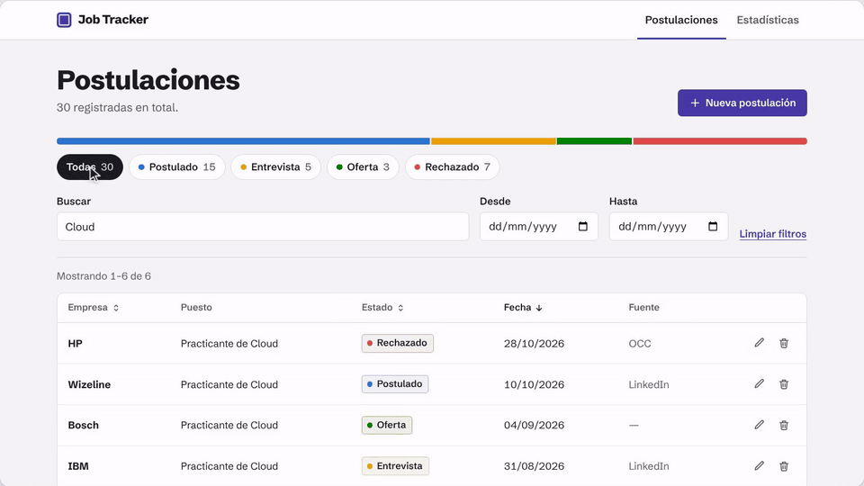
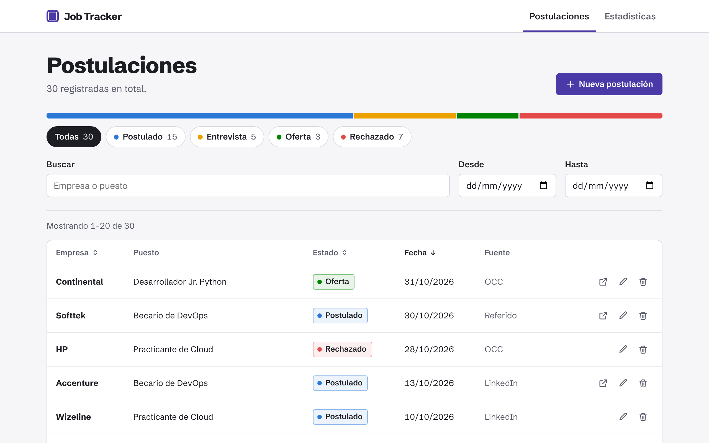
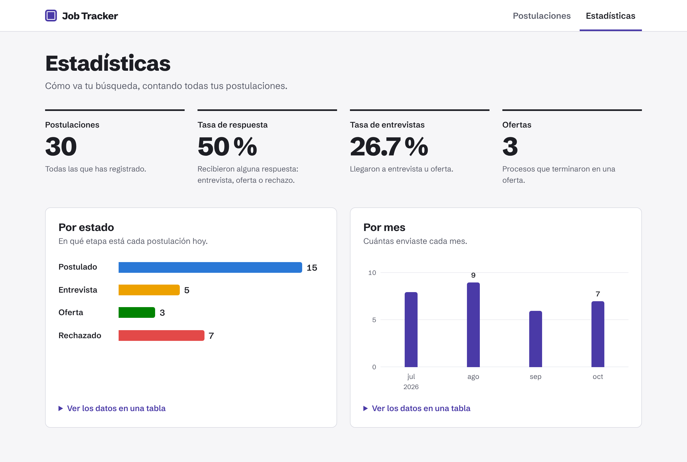
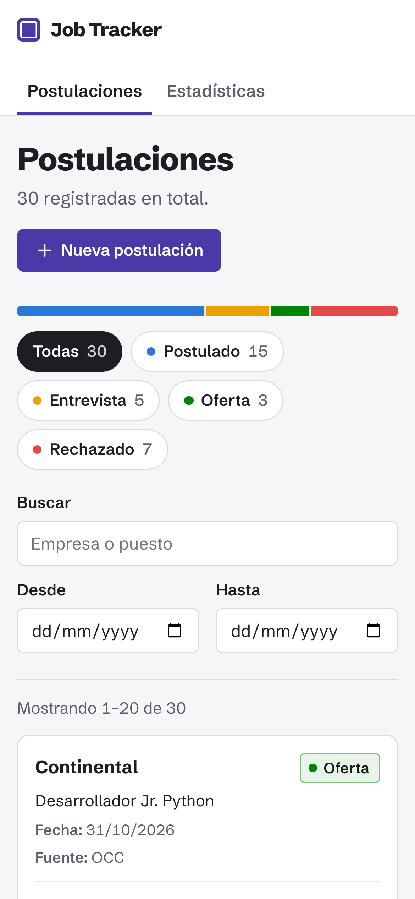
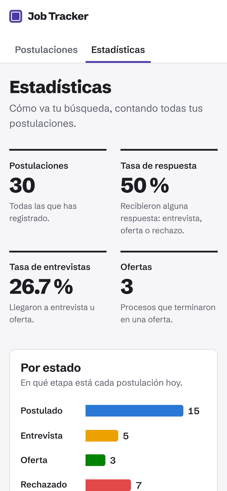
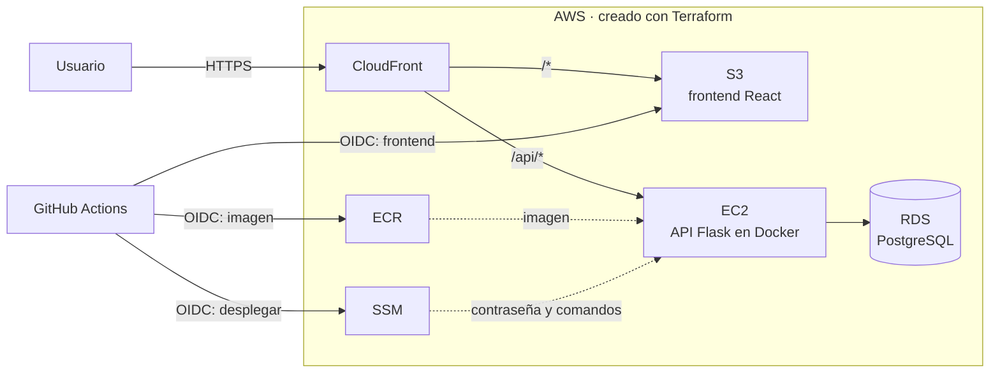
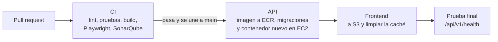

# Job Tracker

[](https://github.com/AndressOlvera/job-tracker/actions/workflows/ci.yml)
[](https://github.com/AndressOlvera/job-tracker/actions/workflows/deploy.yml)
[](https://sonarcloud.io/summary/new_code?id=AndressOlvera_job-tracker)
[](https://sonarcloud.io/summary/new_code?id=AndressOlvera_job-tracker)

Aplicación web para registrar tus postulaciones a empleos y prácticas, darles seguimiento y medir cómo va tu búsqueda.

Es un proyecto full stack de principio a fin: frontend en React, API en Flask, PostgreSQL, Docker, pruebas automáticas en GitHub Actions e infraestructura en AWS creada con Terraform. Cada cambio que se une a `main` se prueba y se publica solo.



🎬 [Video completo de 1 minuto](docs/media/job-tracker-demo.mp4)

## Qué hace

- Registrar postulaciones: empresa, puesto, estado, fecha, enlace, fuente y notas.
- Buscar, filtrar por estado y fecha, ordenar y paginar. Los filtros quedan en la URL.
- Editar y eliminar (con confirmación).
- Estadísticas: total, distribución por estado, postulaciones por mes, tasa de respuesta y tasa de entrevistas.
- Funciona en celular y se puede usar completa con teclado.

| Lista | Estadísticas |
|---|---|
|  |  |

<p align="center">
  
  &nbsp;&nbsp;
  
</p>

## Arquitectura



- El navegador habla con un solo dominio: CloudFront entrega el frontend desde S3 y manda `/api/*` a la API, así que no se necesita CORS.
- La base de datos está en subredes privadas y su contraseña vive en SSM, no en el código ni en el estado de Terraform.
- La instancia no tiene SSH: se administra con SSM Session Manager.

### Cómo se publica un cambio



`main` está protegida: no se puede unir un pull request si falla algún check. GitHub entra a AWS con OIDC, sin llaves guardadas. Detalles en [CI](docs/07-ci.md) y [despliegue](docs/09-despliegue.md).

### ¿Dónde está la app en línea?

Para cuidar los créditos de AWS, la infraestructura no está encendida todo el tiempo: se levanta con `terraform apply` cuando hace falta y se borra con `terraform destroy` (la base de datos se pierde). Por eso está el [video](docs/media/job-tracker-demo.mp4). Si la infraestructura está apagada, el despliegue solo avisa y termina sin error. Los pasos para encenderla están en [docs/08-aws.md](docs/08-aws.md).

## Tecnologías

| Capa | Tecnologías |
|---|---|
| Frontend | React, TypeScript, Vite, React Router, TanStack Query, CSS Modules |
| Backend | Python, Flask, SQLAlchemy, Alembic, Pydantic, Gunicorn |
| Base de datos | PostgreSQL |
| Pruebas | pytest, Vitest, React Testing Library, Playwright |
| Calidad | Ruff, ESLint, Prettier, SonarQube Cloud |
| Contenedores | Docker, Docker Compose, Nginx |
| CI/CD | GitHub Actions (OIDC hacia AWS) |
| Infraestructura | Terraform, AWS (CloudFront, S3, EC2, RDS, ECR, SSM, IAM, VPC) |

## Decisiones de diseño

Las más importantes (todas están en [docs/05-decisiones.md](docs/05-decisiones.md)):

- **Un solo dominio para frontend y API**, sin CORS ([ADR-005](docs/05-decisiones.md#adr-005-mismo-origen-para-frontend-y-api), [ADR-021](docs/05-decisiones.md#adr-021-cloudfront-hace-en-aws-lo-que-nginx-hace-en-docker)).
- **Infraestructura como código y destruible**, para pagar solo cuando se usa ([ADR-007](docs/05-decisiones.md#adr-007-infraestructura-como-código-y-destruible)).
- **Pruebas contra PostgreSQL real** y pruebas de navegador contra Docker Compose ([ADR-010](docs/05-decisiones.md#adr-010-pruebas-contra-postgresql-real), [ADR-017](docs/05-decisiones.md#adr-017-pruebas-de-navegador-contra-docker-compose)).
- **Los filtros viven en la URL**, para compartir o recargar una búsqueda ([ADR-013](docs/05-decisiones.md#adr-013-los-filtros-de-la-lista-viven-en-la-url)).
- **La contraseña de la base nunca pasa por el estado de Terraform** ([ADR-019](docs/05-decisiones.md#adr-019-la-contraseña-de-la-base-de-datos-no-pasa-por-el-estado-de-terraform)).
- **EC2 sin SSH**: se prepara sola al arrancar y se despliega con SSM ([ADR-020](docs/05-decisiones.md#adr-020-la-instancia-ec2-se-prepara-sola-y-se-despliega-con-un-script)).
- **GitHub entra a AWS con OIDC**, con un rol que solo puede usar `main` ([ADR-023](docs/05-decisiones.md#adr-023-github-actions-entra-a-aws-con-oidc)).

## Cómo correrlo localmente

Solo necesitas Docker Desktop:

```bash
cp .env.example .env
docker compose up -d                 # base de datos, migraciones, API y frontend
docker compose exec api flask seed   # opcional: 30 postulaciones de ejemplo
```

Abre `http://localhost:8080`. La guía completa, con los comandos para ver logs, apagar y resolver problemas, está en [docs/06-docker.md](docs/06-docker.md).

Para programar con recarga automática al guardar, se usa el modo desarrollo: la base en Docker (`docker compose up -d db`), la API con `flask run` y el frontend con `npm run dev` (pasos en [backend/README.md](backend/README.md) y [frontend/README.md](frontend/README.md)).

En los dos modos el navegador habla con un solo origen: Nginx (en Docker) o Vite (en desarrollo) reenvían `/api` a la API, así que no hace falta CORS.

### API

Detalle en [docs/03-api.md](docs/03-api.md).

| Método | Ruta | Descripción |
|---|---|---|
| `GET` | `/api/v1/health` | Estado de la API y la base de datos |
| `GET` | `/api/v1/applications` | Lista con filtros, orden y paginación |
| `POST` | `/api/v1/applications` | Crear una postulación |
| `GET` | `/api/v1/applications/{id}` | Obtener una postulación |
| `PATCH` | `/api/v1/applications/{id}` | Modificar algunos campos |
| `DELETE` | `/api/v1/applications/{id}` | Eliminar |
| `GET` | `/api/v1/stats` | Estadísticas |

## Estructura del repositorio

```
job-tracker/
├── backend/                  # API en Flask (ver su README)
├── frontend/                 # Interfaz en React + TypeScript (ver su README)
├── e2e/                      # Pruebas de navegador con Playwright (ver su README)
├── infra/                    # Infraestructura en AWS con Terraform (ver su README)
├── docs/                     # Diseño del proyecto, capturas y video
├── docker/                   # Scripts de arranque de la base de datos
├── docker-compose.yml        # Toda la app en Docker: base de datos, API y frontend
├── sonar-project.properties  # Configuración de SonarQube Cloud
└── .github/                  # Workflows de CI y despliegue, y plantillas
```

## Documentación

1. [Requisitos e historias de usuario](docs/01-requisitos.md)
2. [Modelo de datos](docs/02-modelo-de-datos.md)
3. [API REST](docs/03-api.md)
4. [Pantallas](docs/04-pantallas.md)
5. [Decisiones de diseño (ADR)](docs/05-decisiones.md)
6. [Docker](docs/06-docker.md)
7. [Integración continua (CI)](docs/07-ci.md)
8. [Infraestructura en AWS](docs/08-aws.md)
9. [Despliegue automático (CD)](docs/09-despliegue.md)

El avance por fases está en el [roadmap](ROADMAP.md).

## Licencia

[MIT](LICENSE)
