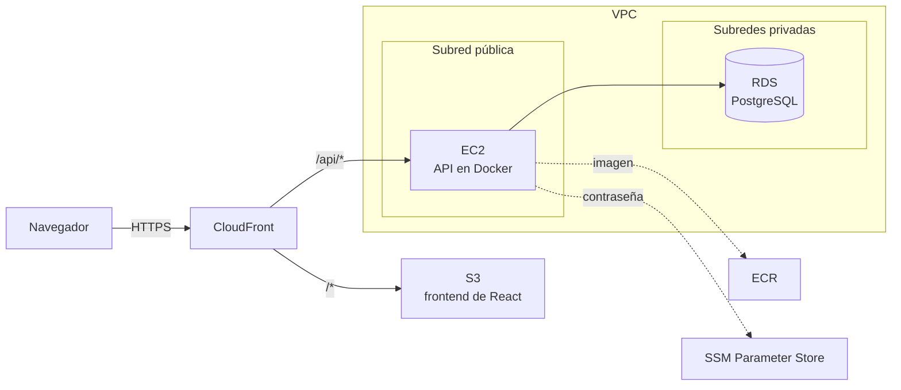

# 8. Infraestructura en AWS

Toda la infraestructura se crea con Terraform, desde la carpeta [`infra/`](../infra). Con un `terraform apply` se levanta todo y con un `terraform destroy` se borra.

## Qué se crea



| Archivo | Qué crea o hace |
|---|---|
| `infra/bootstrap/main.tf` | El bucket de S3 donde Terraform guarda su estado. Se crea una sola vez |
| `infra/main.tf` | Versiones, dónde se guarda el estado y valores generales (región, tamaños) |
| `infra/network.tf` | VPC, 2 subredes públicas, 2 privadas (sin NAT Gateway) y los security groups |
| `infra/database.tf` | La contraseña en SSM Parameter Store y RDS PostgreSQL |
| `infra/api.tf` | El repositorio de ECR, el rol de IAM de la instancia y la instancia EC2 |
| `infra/frontend.tf` | El bucket del frontend y CloudFront, con sus rutas y cabeceras de seguridad |
| `infra/outputs.tf` | Los datos que se usan al desplegar: URL, bucket, ID de la instancia… |
| `infra/scripts/user-data.sh.tftpl` | Lo que hace la instancia al crearse: instala Docker y el script de despliegue |
| `infra/scripts/job-tracker-deploy.sh` | El despliegue de la API: descarga la imagen, migra y reemplaza el contenedor |
| `infra/scripts/spa-routes.js` | Manda las rutas de React (`/stats`…) a `index.html` |

Las decisiones están en los [ADR-019 a ADR-022](05-decisiones.md#adr-019-la-contraseña-de-la-base-de-datos-no-pasa-por-el-estado-de-terraform).

## Cuánto cuesta

Encendida cuesta cerca de **1 USD al día** (sobre todo EC2, RDS y la IP pública), o menos si tu cuenta tiene capa gratuita o créditos. Apagada, con `terraform destroy`, no cuesta nada: solo queda el bucket del estado, que pesa unos KB.

Recuerda que la app no tiene inicio de sesión ([ADR-004](05-decisiones.md#adr-004-sin-autenticación-en-el-mvp)): mientras esté encendida, cualquiera con la URL puede ver y cambiar los datos.

## Preparación (una sola vez)

Todos los comandos van en la terminal de Ubuntu.

### 1. Instalar Terraform y la AWS CLI

Terraform ([guía oficial](https://developer.hashicorp.com/terraform/install)):

```bash
wget -O - https://apt.releases.hashicorp.com/gpg | sudo gpg --dearmor -o /usr/share/keyrings/hashicorp-archive-keyring.gpg
echo "deb [arch=$(dpkg --print-architecture) signed-by=/usr/share/keyrings/hashicorp-archive-keyring.gpg] https://apt.releases.hashicorp.com $(grep -oP '(?<=UBUNTU_CODENAME=).*' /etc/os-release || lsb_release -cs) main" | sudo tee /etc/apt/sources.list.d/hashicorp.list
sudo apt update && sudo apt install terraform
terraform -version            # 1.11 o más nueva
```

AWS CLI:

```bash
cd ~
curl "https://awscli.amazonaws.com/awscli-exe-linux-x86_64.zip" -o awscliv2.zip
unzip -q awscliv2.zip
sudo ./aws/install            # si ya la tenías: sudo ./aws/install --update
rm -rf awscliv2.zip aws
aws --version                 # 2.32 o más nueva
```

### 2. Conectar la terminal con tu cuenta de AWS

Se usa `aws login`, que da credenciales temporales con tu inicio de sesión de la consola, sin llaves de acceso permanentes ([ADR-022](05-decisiones.md#adr-022-credenciales-temporales-en-la-computadora-aws-login)). Inicia sesión con tu usuario de IAM, no con la cuenta root. Ese usuario necesita la política `AdministratorAccess`, porque Terraform crea recursos de muchos servicios, incluido IAM.

```bash
aws login --remote --profile job-tracker-login
```

1. Si te pregunta la región, escribe `us-east-1`.
2. Abre en el navegador de Windows la URL que aparece e inicia sesión.
3. Copia el código que te muestra la página y pégalo en la terminal.

Después crea el perfil que usan Terraform y Docker, y déjalo como el de siempre. (`cli_pager =` hace que la AWS CLI muestre las respuestas directo en la terminal, sin abrir un visor del que hay que salir con `q`.)

```bash
cat >> ~/.aws/config <<'EOF'

[profile job-tracker]
credential_process = aws configure export-credentials --profile job-tracker-login --format process
region = us-east-1
cli_pager =
EOF
echo 'export AWS_PROFILE=job-tracker' >> ~/.bashrc
source ~/.bashrc

aws sts get-caller-identity   # en "Arn" debe aparecer :user/ y el nombre de tu usuario
```

La sesión dura 12 horas. Después, vuelve a correr solo el `aws login --remote --profile job-tracker-login`.

### 3. Crear el bucket del estado

```bash
cd ~/proyectos/job-tracker/infra/bootstrap
terraform init
terraform apply               # revisa el plan y escribe yes
```

Crea el bucket `job-tracker-tfstate-<tu número de cuenta>`. No se destruye con el resto.

## Levantar la infraestructura

```bash
cd ~/proyectos/job-tracker/infra
# Solo la primera vez: conecta Terraform con el bucket del estado
terraform init -backend-config="bucket=job-tracker-tfstate-$(aws sts get-caller-identity --query Account --output text)"

terraform plan                # muestra lo que va a crear (32 recursos)
terraform apply               # escribe yes; tarda unos 15 minutos
```

RDS y CloudFront son los más lentos. Al terminar, Terraform muestra los `outputs`, entre ellos `app_url`. Si abres la URL ahora verás un error `AccessDenied`: la infraestructura ya existe, pero falta subir la app, que es el siguiente paso.

## Primer despliegue

Necesitas Docker Desktop abierto. Desde la raíz del proyecto, guarda los datos que da Terraform en variables de la terminal:

```bash
cd ~/proyectos/job-tracker
REPO=$(terraform -chdir=infra output -raw ecr_repository_url)
INSTANCE=$(terraform -chdir=infra output -raw api_instance_id)
BUCKET=$(terraform -chdir=infra output -raw frontend_bucket)
DISTRIBUTION=$(terraform -chdir=infra output -raw cloudfront_distribution_id)
```

Estas variables solo existen en esa terminal. Si abres otra, vuelve a correr esas líneas.

### 1. Subir la imagen de la API a ECR

```bash
# Inicia sesión en ECR (${REPO%%/*} es la parte de la dirección antes de la primera /)
aws ecr get-login-password | docker login --username AWS --password-stdin "${REPO%%/*}"
docker build -t "$REPO:latest" backend
docker push "$REPO:latest"
```

### 2. Arrancar la API en EC2

Con SSM Run Command se ejecuta el script de despliegue en la instancia, sin SSH:

```bash
COMMAND=$(aws ssm send-command --instance-ids "$INSTANCE" --document-name AWS-RunShellScript \
  --parameters 'commands=["/usr/local/bin/job-tracker-deploy"]' \
  --query Command.CommandId --output text)
aws ssm wait command-executed --command-id "$COMMAND" --instance-id "$INSTANCE"
aws ssm get-command-invocation --command-id "$COMMAND" --instance-id "$INSTANCE" \
  --query StandardOutputContent --output text
```

La salida debe terminar con `==> Listo: la API corre con …:latest`. El script descarga la imagen, aplica las migraciones en RDS, arranca el contenedor y revisa que `GET /api/v1/health` responda.

Si el `wait` falla, mira el error con el mismo `get-command-invocation`, cambiando `StandardOutputContent` por `StandardErrorContent`.

### 3. Subir el frontend

```bash
cd frontend
nvm use
npm ci
npm run build
# Los archivos de assets/ cambian de nombre en cada versión: se guardan en caché un año
aws s3 sync dist/assets "s3://$BUCKET/assets" --cache-control "public, max-age=31536000, immutable"
# index.html y lo demás sin caché, para que siempre apunten a la versión nueva
aws s3 sync dist "s3://$BUCKET" --exclude "assets/*" --delete --cache-control "no-cache"
# Borra la copia vieja que CloudFront tenga guardada
aws cloudfront create-invalidation --distribution-id "$DISTRIBUTION" --paths "/*"
cd ..
```

### 4. Cargar datos de ejemplo (opcional)

```bash
aws ssm send-command --instance-ids "$INSTANCE" --document-name AWS-RunShellScript \
  --parameters 'commands=["docker exec job-tracker-api flask seed"]' \
  --query Command.CommandId --output text
```

### 5. Comprobar

```bash
APP_URL=$(terraform -chdir=infra output -raw app_url)
curl "$APP_URL/api/v1/health"   # {"status":"ok","database":"ok"}
echo "$APP_URL"
```

Abre la URL en el navegador. Revisa que:

- Se vea la lista de postulaciones.
- Puedas crear, editar y eliminar una postulación.
- Al recargar en `/stats` siga apareciendo la pantalla de estadísticas.

## Apagar todo

```bash
cd ~/proyectos/job-tracker
terraform -chdir=infra destroy   # escribe yes; tarda unos 15 minutos
```

Se borra todo menos el bucket del estado: la base de datos con sus datos, las imágenes de ECR y los archivos del frontend.

Para volver a levantarla, corre `terraform -chdir=infra apply` y repite el [primer despliegue](#primer-despliegue). La URL de CloudFront cambia cada vez que se vuelve a crear.

## Entrar a la instancia

No hay SSH. En la consola de AWS ve a **EC2 → Instances**, selecciona `job-tracker-api` y haz clic en **Connect → Session Manager → Connect**. Se abre una terminal en el navegador.

| Comando | Qué hace |
|---|---|
| `sudo docker ps` | Muestra si el contenedor de la API está corriendo |
| `sudo docker logs --tail 50 job-tracker-api` | Últimas líneas del log de la API |
| `curl localhost/api/v1/health` | Prueba la API desde la instancia, sin pasar por CloudFront |
| `sudo /usr/local/bin/job-tracker-deploy` | Vuelve a desplegar la imagen `latest` |
| `sudo cat /var/log/cloud-init-output.log` | Qué pasó cuando se creó la instancia |

## Problemas comunes

| Síntoma | Solución |
|---|---|
| `aws: error: argument command: Invalid choice` al usar `aws login` | Tu AWS CLI es vieja. Actualízala con los pasos de [Instalar Terraform y la AWS CLI](#1-instalar-terraform-y-la-aws-cli). |
| Terraform o la AWS CLI fallan con un error de credenciales o de `credential_process` | Venció la sesión de 12 horas. Corre otra vez `aws login --remote --profile job-tracker-login`. |
| `terraform init` dice que el bucket no existe | Falta [crear el bucket del estado](#3-crear-el-bucket-del-estado), o estás en otra cuenta (revisa `aws sts get-caller-identity`). |
| `send-command` responde `InvalidInstanceId` | La instancia acaba de crearse y todavía no se registra en SSM. Espera uno o dos minutos. |
| El despliegue falla en `docker pull` con `not found` | Falta [subir la imagen a ECR](#1-subir-la-imagen-de-la-api-a-ecr). |
| La página muestra `AccessDenied` | Falta [subir el frontend](#3-subir-el-frontend), o la invalidación aún no termina (tarda un par de minutos). |
| La app dice "La API no respondió" | La API no está corriendo. Entra a la instancia y revisa `sudo docker logs job-tracker-api`, o repite el [paso 2](#2-arrancar-la-api-en-ec2). |
