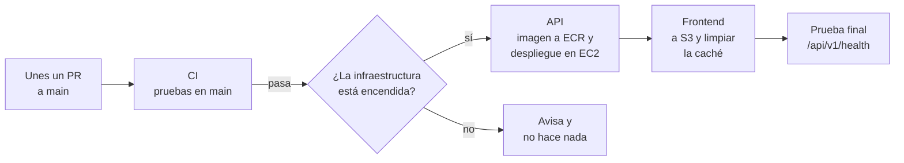

# 9. Despliegue automático (CD)

Cuando unes un pull request a `main`, GitHub Actions publica el cambio en AWS solo. El workflow está en [`.github/workflows/deploy.yml`](../.github/workflows/deploy.yml).

## Cómo funciona



| Paso | Qué hace |
|---|---|
| **Espera a la CI** | El workflow Deploy solo arranca cuando la CI termina bien en `main`. Si algo falla en `main`, no se publica nada |
| **Revisa la infraestructura** | Lee en SSM los datos que guarda `infra/deploy.tf`. Si no están, porque hiciste `terraform destroy`, muestra un aviso y termina sin error |
| **API** | Construye la imagen, la sube a ECR con la etiqueta del commit y `latest`, y corre `job-tracker-deploy` en EC2 con SSM Run Command: aplica las migraciones y reemplaza el contenedor |
| **Frontend** | Compila la app, sube los archivos a S3 e invalida la caché de CloudFront |
| **Prueba final** | Revisa que `/api/v1/health` y la página respondan a través de CloudFront. Si no, el workflow sale en rojo |

El despliegue tarda unos 5 minutos, más lo que tarde la CI antes.

## Cómo entra a AWS sin llaves (OIDC)

En GitHub no hay ninguna llave de AWS guardada:

1. En cada ejecución, GitHub le da al workflow un token firmado que dice "soy el repositorio `AndressOlvera/job-tracker`, rama `main`".
2. AWS revisa la firma, el repositorio y la rama.
3. Si todo coincide, entrega credenciales temporales (1 hora) del rol `job-tracker-github-deploy`.

Ese rol solo puede leer los datos del despliegue, subir la imagen de la API, mandar comandos a la instancia de la API, subir archivos al bucket del frontend e invalidar la caché de CloudFront. Un pull request u otra rama no lo puede usar. Detalles en el [ADR-023](05-decisiones.md#adr-023-github-actions-entra-a-aws-con-oidc).

## Configuración única

### 1. Crear la conexión en AWS

```bash
aws login --remote --profile job-tracker-login   # si ya venció tu sesión
cd ~/proyectos/job-tracker/infra/bootstrap
terraform apply
```

Debe decir `Plan: 3 to add`: el proveedor OIDC, el rol y sus permisos. Al final muestra:

```
github_deploy_role_arn = "arn:aws:iam::...:role/job-tracker-github-deploy"
```

Esto vive junto al bucket del estado y no se destruye con `terraform destroy`.

### 2. Guardar el rol en GitHub

En el repositorio: **Settings → Secrets and variables → Actions → pestaña Variables → New repository variable**.

| Campo | Valor |
|---|---|
| Name | `AWS_DEPLOY_ROLE_ARN` |
| Value | El `github_deploy_role_arn` del paso anterior, sin comillas |

Va como **variable** y no como secreto porque no es una contraseña: el ARN solo, sin el token de GitHub, no da acceso a nada.

## Uso diario

| Quieres… | Haz esto |
|---|---|
| Publicar un cambio | Únelo a `main` con un pull request. El avance se ve en **Actions → Deploy** |
| Publicar después de `terraform apply` | **Actions → Deploy → Run workflow**, elige `main` y haz clic en **Run workflow** |
| Volver a una versión anterior | En **Actions → Deploy**, abre el despliegue de ese commit y haz clic en **Re-run all jobs**. No funciona si después de esa versión hubo una migración de la base: la base ya va adelante |
| Apagar la app | `terraform -chdir=infra destroy`. Las siguientes uniones a `main` no despliegan; solo avisan |

## Comprobar que funciona

La fase está terminada cuando unes un pull request y, en unos minutos, el cambio está en línea:

1. Levanta la infraestructura (`terraform -chdir=infra apply`) y corre **Deploy → Run workflow** para publicar la versión actual.
2. En una rama nueva, cambia algo visible. Por ejemplo, en `frontend/src/components/Layout.tsx` cambia el texto `Job Tracker` del encabezado por `Job Tracker (demo)`.
3. Abre el pull request, espera la CI y únelo.
4. En **Actions**, mira cómo corre la CI en `main` y después Deploy.
5. Cuando Deploy esté en verde, abre la URL de la app y recarga con `Ctrl + Shift + R`: debe aparecer el cambio.

## Problemas comunes

| Síntoma | Solución |
|---|---|
| Deploy dice "Falta la variable AWS_DEPLOY_ROLE_ARN" | Falta el [paso 2 de la configuración](#2-guardar-el-rol-en-github). |
| Deploy dice "La infraestructura de AWS está apagada" | Es normal si hiciste `terraform destroy`. Levántala y usa **Run workflow**. |
| `Not authorized to perform sts:AssumeRoleWithWebIdentity` | El valor de la variable está mal copiado. Revísalo con `terraform -chdir=infra/bootstrap output github_deploy_role_arn`. |
| `EntityAlreadyExists` al crear el proveedor OIDC | Tu cuenta ya tenía uno para GitHub, de otro proyecto o tutorial. Impórtalo con `terraform import aws_iam_openid_connect_provider.github "arn:aws:iam::$(aws sts get-caller-identity --query Account --output text):oidc-provider/token.actions.githubusercontent.com"` y vuelve a correr `terraform apply`. |
| Falla el paso "Desplegar la API en EC2" | Abre el paso: muestra lo que pasó en la instancia, como una migración que falló o la API que no respondió. |
| Deploy no aparece después de unir | Solo corre si la CI pasó en `main`; revisa esa ejecución. |
| No ves el cambio en la página | Recarga sin caché con `Ctrl + Shift + R`. |
